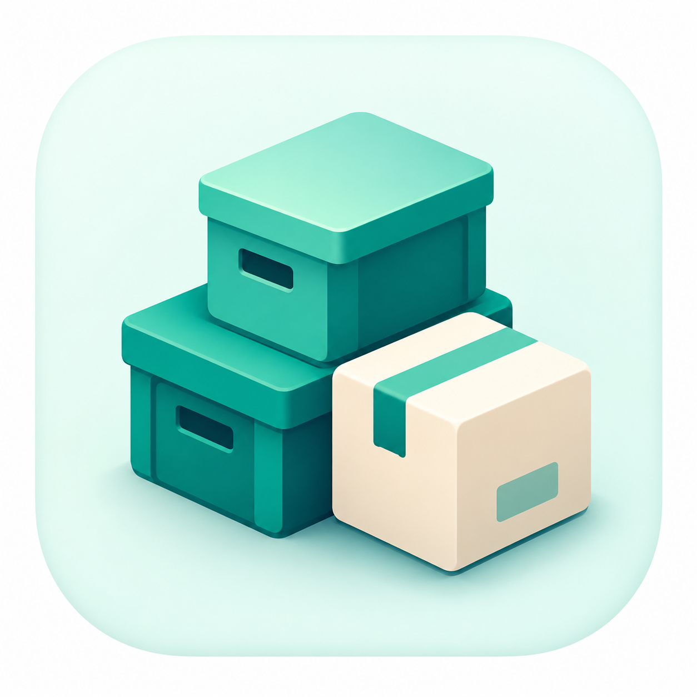

# 智能仓储

<p align="center">
  
</p>

<p align="center">
  <strong>收货核对 · 批次库存 · 出库留痕</strong>
</p>

<p align="center">
  <a href="#"></a>
  <a href="#"></a>
  <a href="#"></a>
  <a href="#"></a>
  <a href="./LICENSE"></a>
</p>

“智能仓储”是一款 Android 单机仓储管理原型，围绕收货核对、批次库存、出库留痕和补货分析建立可演示的作业闭环。原有的个人物品管理能力仍保留在应用中。

本项目在原有开源项目基础上继续开发，仓储页面改为深蓝与青绿色视觉，并加入本地库存流水和可人工核对的照片识别流程。项目继续遵循并保留原项目的 MIT License。

## 智能仓储改造进度（1.8.1）

当前主入口为本地单仓工作台、库存、分析和我的。仓储商品、批次、待确认单据及库存流水保存在 Room 中；收货和出库须先保存草稿并核对，确认后才更新库存和流水。拍照及相册图片可附到草稿；比赛 APK 已预设个人识别服务，点击后将第一张照片发送至 DeepSeek 提取候选字段，人工核对后填入表单。设备语音识别结果可手动编辑并由本地规则提取带标签的字段。盘点可按实盘数调整批次，移库可改变整个批次的库位，两者都记录流水。数据库升级会保留原家庭物品记录，ZIP 备份包含仓储数据及草稿图片。分析页按近 14 天有效出库和每个商品的安全库存、目标覆盖天数计算补货建议。旧云函数入口已停用；新识别服务代码位于 [competition-worker](competition-worker/README.md)，已部署到参赛者自己的 Cloudflare 账号。DeepSeek Key 仅存放在服务端 Secret；比赛版演示口令可从 APK 中提取，Worker 有每节点及来源限流。当前仍需真机照片识别联调。比赛准备见 [参赛清单](docs/competition-2026-checklist.md)。

---

## 当前功能

### 物品管理

- 拍照或跳过拍照快速录入物品。
- 记录名称、图片、分类、存放位置、数量、有效期、价格和备注。
- 查看物品详情，支持编辑、标记已用完、评价和删除。
- 在首页按分类筛选最近添加的物品。
- 在库房中搜索物品名称、分类、位置或备注。
- 按全部、已用完、待评价、已评价等状态查看物品。

### 分类、位置与生命周期

- 按分类或存放位置两个维度浏览物品。
- 支持新增、编辑和删除分类。
- 支持创建多级存放位置，例如“宿舍 -> 衣柜 -> 下层”。
- 删除物品后先进入回收站，30 天内可恢复。
- 支持回收站批量恢复和永久删除。
- 物品标记为已用完后，可进行星级评价并填写评价内容。

### 到期提醒

- 使用 WorkManager 约每 12 小时检查一次物品有效期。
- 对未来 7 天内到期或已经过期的物品发送本地通知。
- 对同一物品的相同提醒状态进行当天去重。
- 可在“我的 -> 到期提醒”中集中查看需要关注的物品。

### “小东西”智能体

- 支持文字对话、语音输入、拍照和相册图片。
- 可查询物品、分类、位置、库存状态和即将过期物品。
- 可通过工具调用修改真实物品数据，并对高风险操作进行确认。
- 支持图片理解与物品录入辅助。
- 支持结合高德天气回答天气、出行和生活建议类问题。
- 保存和搜索历史对话。

### 设置与数据

- 在“我的 -> AI 服务状态”中查看文字、图片、语音和天气服务状态。
- 导出 ZIP 数据备份，并从 ZIP 备份恢复数据。
- 检查新版本、下载并调起安装。
- 使用 Room 在设备本地保存物品与配置数据。

---

## 当前仓储视觉

- 仓储主界面采用深蓝文字、青绿色操作色和浅色背景。
- 应用图标采用青绿色立体仓箱，启动画面与下载页使用同一图形。
- 主导航为工作台、库存、分析、我的；收货和出库通过工作台的快捷入口进入。

## 下载体验版

[打开下载页](https://elowen-cat.github.io/zhinengcangchu/) · [直接下载 Android APK](https://elowen-cat.github.io/zhinengcangchu/smart-warehouse-1.8.1.apk)

网站文件位于 `docs/`，通过 GitHub Pages 发布。APK 中不含 DeepSeek API Key，照片识别需要联网访问独立的 Cloudflare Worker；手动入库、出库和库存查询使用手机本地数据。

**识别服务迁移进度（2026-10-18）：** 有真机遇到 `workers.dev` 连接超时，旧版其他功能所用的阿里云地址不能作为本项目的后端。已准备[腾讯云云函数版本](tencent-scf/README.md)及可配置的 Android 构建地址；尚无腾讯云账号，服务未部署，不能把现有下载包称为已修复。新函数在实际手机上可达并完成照片识别后，才会发布新版 APK。

---

## 页面入口

| 页面 | 主要能力 |
| --- | --- |
| 工作台 | 收货、出库、盘点、移库和待处理事项 |
| 库存 | 商品与批次库存、位置、效期和明细 |
| 分析 | 出库趋势、覆盖天数与补货建议 |
| 我的 | 备份、设置及原有个人物品管理入口 |

---

## 技术栈

- Kotlin 2.1
- Jetpack Compose + Material 3
- Navigation Compose
- MVVM
- Room
- Hilt
- WorkManager
- CameraX
- Coil
- Kotlin Coroutines
- Kotlin Serialization
- OkHttp
- Haze 毛玻璃效果

架构主链路：

```text
Compose UI -> ViewModel -> Repository / Agent Tool -> Room DB / Secure Proxy -> External API
```

---

## 项目结构

```text
app/src/main/java/com/youshu/app/
├─ data/
│  ├─ agent/          # 小东西智能体、库存工具、天气工具与对话历史
│  ├─ ai/             # 文字、图片与语音推理调用
│  ├─ backup/         # ZIP 数据备份与恢复
│  ├─ local/          # Room 实体、DAO、数据库与迁移
│  ├─ repository/     # 数据仓库层
│  └─ update/         # 版本检查、下载与安装
├─ di/                # Hilt 依赖注入
├─ ui/
│  ├─ components/     # 通用 UI 与毛玻璃组件
│  ├─ navigation/     # 路由与底部导航
│  ├─ screen/         # 页面实现
│  ├─ theme/          # 紫色视觉主题
│  └─ viewmodel/      # 页面状态与交互逻辑
├─ util/              # 到期通知、日期、图片和录音工具
├─ MainActivity.kt
└─ YouShuApplication.kt
```

---

## 构建与安装

### 环境要求

- Android Studio 最新稳定版
- JDK 17
- Android SDK 35
- Android 8.0（API 26）及以上运行设备

### 构建 Debug APK

macOS / Linux：

```bash
./gradlew :app:assembleDebug
```

Windows：

```powershell
.\gradlew.bat :app:assembleDebug
```

生成的 APK：

```text
app/build/outputs/apk/debug/app-debug.apk
```

安装到已连接的 Android 设备：

```powershell
adb install -r .\app\build\outputs\apk\debug\app-debug.apk
```

---

## 首次体验路径

1. 进入“分类”，创建常用分类与存放位置。
2. 点击底部中央拍照按钮，录入第一件物品。
3. 进入“库房”，尝试搜索、标记已用完和评价。
4. 进入“我的 -> 到期提醒 / 回收站”，查看生命周期管理能力。
5. 从首页进入“小东西”，尝试询问“我的充电器放在哪里？”或“有哪些东西快过期了？”。

---

## AI 服务与密钥安全

Android 应用不保存、展示或直接发送任何第三方 API Key。应用通过阿里云函数计算中的固定代理路由访问服务，评委安装后无需注册，也无需手动填写密钥。

| 用途 | 当前预置服务 | 主要能力 |
| --- | --- | --- |
| 文字搜索 | DeepSeek | 小东西对话、物品查询和管理工具调用 |
| 图片识别 | 通义千问 Qwen | 图片理解与物品录入辅助 |
| 天气服务 | 高德天气 | 天气查询与生活建议 |

服务端部署方法、环境变量名称和验证步骤见 [`server/DEPLOY.md`](./server/DEPLOY.md)。真实密钥只应填写在函数计算环境变量中，绝不能写入 Git、Gradle 配置、APK、日志或公开材料。

---

## 权限说明

| 权限 | 用途 |
| --- | --- |
| 相机 | 拍照录入、智能体拍照发送图片 |
| 麦克风 | 向小东西进行语音提问 |
| 照片 / 媒体 | 从相册选择图片 |
| 通知 | 展示物品到期提醒 |
| 定位 | 为天气查询提供位置 |
| 网络 | 智能体、图片识别、天气和检查更新 |

---

## 开源与致谢

本项目基于原开源项目继续开发，并保留其 MIT License。感谢原作者和所有开源依赖的贡献者。

问题反馈 / 讨论：[Linux.do 社区](https://linux.do/)

## License

[MIT](./LICENSE)
